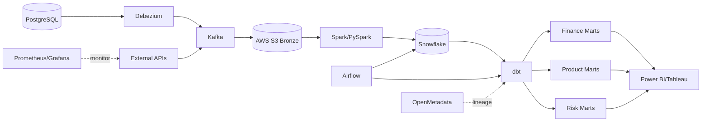

# Target Architecture

## Design principles
- Batch + streaming
- Reproducible infrastructure
- Automated testing and controls
- Least-privilege access
- Business-owned metrics
- End-to-end lineage
